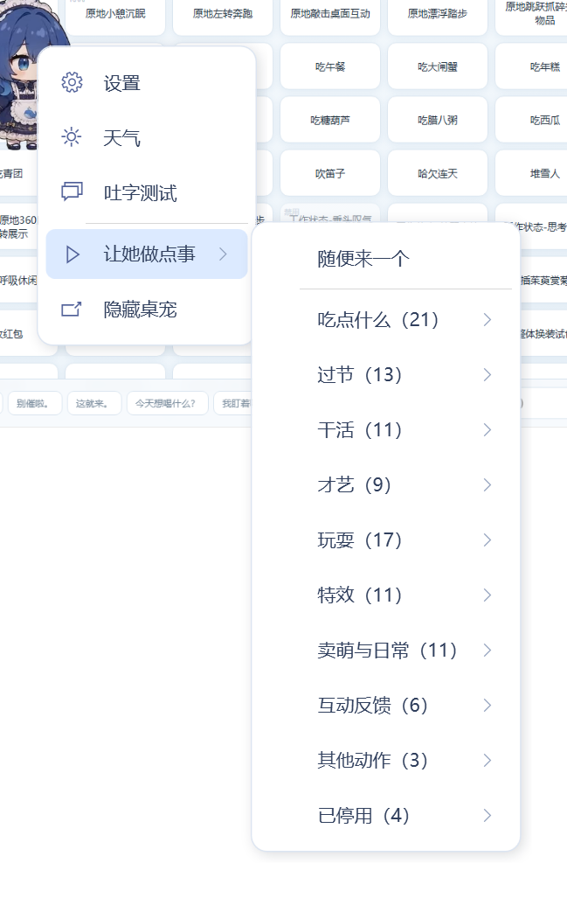
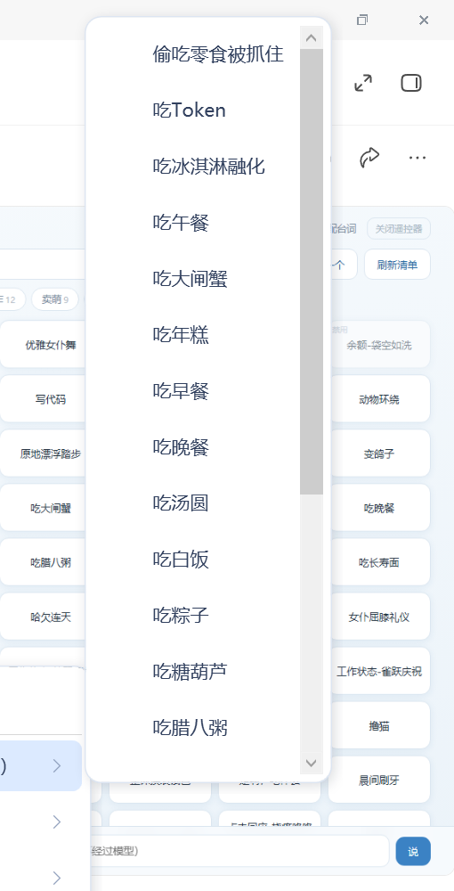

# 蓝色大肥鱼 · 聚合版 v1.2

> 给 [Bai-Cute 的蓝色大肥鱼桌面宠物](https://github.com/Bai-Cute/big-blue-fish-desktop-pet) 加了一整套「她真的在陪你」的能力。
>
> 不调云端 API，不用你的 token，截图和文字都不出本机。


---

## 先说清楚这是什么

这不是一个独立程序，是**给上游 v1.0.1 打的一个补丁**。

- 桌宠本体、动画素材、人格设定的版权都归原作者 **[Bai-Cute](https://github.com/Bai-Cute)**
- 上游是 **Apache License 2.0**，允许修改和再分发
- 本仓库**不包含**上游的源代码和 52 MB 的动画素材，只包含我们写的那部分：补丁、文档、截图、测试脚本

装法就是：拿上游 v1.0.1 → 打补丁 → 编译 → 替换一个 dll。全程三分钟。

---

## 上游 v1.0.1 是什么样

她会呼吸、会播动画、能通过 MCP 接口说话。但你得自己点、自己喊：

- 动画是固定的几套，看久了就那几下
- 你不知道她"饿不饿""开不开心"，她也不会主动开口
- 屏幕上的东西她看不见（OCR 模式只读文字，不知道你在打游戏还是写代码）
- 想让她做点别的动作？得改代码

---

## v1.2 加了什么

### 1. 右键动作菜单：106 个动作，一个不落

右键 →「让她做点事」，按官方元数据（`Meal` / `Festival` / `WorkKind` / `Pool`）+ 动作名关键词自动分成 10 组：

| 分组 | 数量 | 代表动作 |
|---|---|---|
| 吃点什么 | 21 | 吃早餐、涮火锅、吃西瓜、偷吃零食被抓住 |
| 过节 | 13 | 中秋赏月吃月饼、堆雪人、放烟花、收红包、装点圣诞树 |
| 干活 | 11 | 写代码、工作状态-忙碌点按、深度思考碎碎念 |
| 才艺 | 9 | 优雅女仆舞、吹笛子、扑克魔术、下五子棋 |
| 玩耍 | 17 | 放风筝、撸猫、荡秋千、玩水枪、踢毽子 |
| 特效 | 11 | 蓝鲸现世、变鸽子、动物环绕、被落叶淹没 |
| 卖萌与日常 | 11 | 哈欠连天、超大伸懒腰、悠闲哼歌、萌化小幽灵 |
| 互动反馈 | 6 | 点击回应-傲娇生气 / 元气挥手 / 害羞惊讶 / 开心跃动 / 挠痒咯咯笑 |
| 其他动作 | 3 | 余额-金袋叮当 / 钱袋如常 / 钱袋满溢 |
| 已停用 | 4 | 作者标记停用的，菜单里灰着但能看到 |

外加一个「随便来一个」。三级菜单（特效 → 动物环绕）也照常工作。





### 2. 106 个动作全部会自己播（这是 v1.2 的重点）

**原来的问题比想象的深。** 上游只有 `Pool=Event` 的 91 个动作会被自动播：

| Pool | 数量 | 上游行为 |
|---|---|---|
| `Event` | 91 | ✅ 定时自播 |
| `Idle` | 3 | ✅ 兜底待机 |
| `Click` | 5 | ❌ 只在你点她时 |
| `Drag` | 1 | ❌ 只在拖拽时 |
| `Greeting` / `Daily` | 2 | ❌ 只在启动 / 23:00 |
| `Disabled` | 4 | ❌ 永不播 |

更关键的是 `animations.json` 里作者给的 `Weight` 跨度是 **0 ~ 1000（50 倍）**，再加上四类约束会把权重直接压成 **0**：

| 约束 | 字段 | 效果 |
|---|---|---|
| 只在夜里 | `NightOnly` | 白天权重 0 |
| 只在某个季节 | `SeasonOnly` | 其他季节权重 0 |
| 只在节日前后 | `Festival` + `RadiusDays` | 距离节日太远权重 0 |
| 只在整点前后 | `MoveKind` + `HourParity` | 分钟不在 0~5 / 55~60 或小时奇偶不对 → 权重 0 |

结果就是：中秋赏月、堆雪人、放烟花这些动作，**一年里绝大多数时间根本不可能出现**。

**改法**（`CompanionAnimations.ChooseAutoAction()`）：

```
候选池 = 所有动作，排除 Disabled 和 Drag   → 101 个
基础权重 = 官方 Weight()
           如果算出来 ≤ 0（被约束压掉了）→ 给保底值 25
压缩     = 取 0.35 次方 × 15
           50 倍跨度收敛到 4~5 倍，常见动作还是更常见，但没有动作会被饿死
池子系数 = Click ×0.60 / Idle ×0.60 / Greeting·Daily ×0.30 / 其余 ×1.0
反重复   = 上一个播的 ×0.05，最近 8 个里出现过的 ×0.30
按权重轮盘随机
```

实测 2000 次采样的真实分布：

```
覆盖 101 / 101 个可播动作，一个都没漏
Click 池 5 个动作各自命中 5 ~ 11 次
最少 4 次、中位 18 次、最多 54 次（吃白饭）
```

换算成时间（默认 40 秒一次）：中位动作约 **75 分钟**轮到一次，最常见的 25 分钟一次，
最稀有的（请安 / 刷牙 / 少数节日动作）约 5 小时一次——它们本来就有专门的触发时机。

开关在设置 → 鱼鱼的日常 → 「所有动作都会自己播」，关掉完全退回原版行为。

### 3. 从「读字」升级成「看图」

上游是 OCR 模式：用 Windows OCR 读屏幕上的**文字**，看不见画面。所以她永远不知道你在打什么游戏、看什么视频、图里是什么。

现在改成多模态：把当前窗口截成 768px 的图，直接喂给 Qwen3.5-4B 的视觉编码器。

**这里有个必须记住的坑**：8 GB 显存放不下视觉编码器——mmproj 计算图要一次性申请约 **4.85 GB**，必然 `ErrorOutOfDeviceMemory`，llama-server 直接崩，症状是请求返回 502、进程消失、日志里一句报错都没有。

解法是启动参数加：

```
--no-mmproj-offload      视觉编码器留 CPU
--image-max-tokens 256   限制视觉 token
```

代价是每次多 2~3 秒。实测 768×461 截图**首字 3.1 秒**，语言模型仍全量上 GPU。

视觉投影文件（642 MB）在上游的 `models/` 里没有，需要自己下：
`modelscope.cn/models/unsloth/Qwen3.5-4B-GGUF` → `mmproj-F16.gguf`，
放到 `models/Qwen3.5-4B-heretic.mmproj-f16.gguf`（文件名是代码里写死的）。

### 4. 看屏幕汇报（替代原来的「抄字到剪贴板」）

右键「鱼鱼的日常 → 看看主人在干什么」。

她要做的**不是抄字**，是看懂画面，然后说两件事：**主人在干什么 + 她自己的想法**。不往剪贴板写任何东西。

实测三条真实输出：

> 主人在写代码对比大模型效果呢，哇，这逻辑好清晰呀。唔，鱼鱼有点心疼，是不是写得太累了？

> 主人正在对着代码发愁呢，眉头都皱起来了。唔，鱼鱼觉得主人好厉害，居然能……

> 唔，主人～你在给大肥鱼写文档呀，还在跑测试！鱼鱼好佩服主人这么认真……

人设里明确写了「不要汇报口吻、不要说根据截图、不要罗列界面元素」，不然 4B 模型很容易写成说明书。

OCR 版走另一条路：先用 Windows OCR 读出文字，再让模型根据文字猜 + 发表感想。

### 5. 养成数值 + 右上角仪表

三个 0~100 的数值，实时显示在她右上角：

- ♥ 好感、🍚 饱食、⚡ 精力，每格一根短条
- 平时安静待着，**低于 25 才轻轻脉动**（吸引注意但不烦人）
- 数值一变（喂食、摸头）那一条会闪一下
- 点一下仪表，她说一句自己的状态（「好感 58｜饱食 76｜精力 84」）
- 气泡会自动往左让 44 px，不会盖住仪表

**投喂数值**：一次只加 **2.5**——饱食 50 → 100 正好要喂 **20 次**，让"喂她"变成一个长期的日常动作。既然涨得慢，衰减也从 4/时 降到 **1.5/时**，否则喂一次连 40 分钟都撑不住，永远补不回来。

**投喂动作**：从「吃点什么」整组 **21 个**里随机（吃早餐 / 涮火锅 / 吃西瓜 / 偷吃零食被抓住…）。实测 14 次投喂出现 9 种不同吃法。

**反向也通了**：在「让她做点事 → 吃点什么」里点某道菜，她真的吃下去——播你点的那个动作，饱食同样 +2.5。不然会出现"明明看她吃了，饱食一点没涨"的怪事。

### 6. 好感度从哪来（v1.2 从 2 个来源扩到 6 个）

| 来源 | 加多少 | 递减 / 冷却 |
|---|---|---|
| 摸头（单击她） | +0.5 | 无 |
| 右键点任意一个动作 | **+0.5** | 同一个动作 10 分钟内重复只 +0.1 |
| 喂她吃一次 / 点某道菜 | **+5** | 10 分钟内再喂只 +1 |
| 双击找她聊天 | **+1** | 5 分钟最多一次 |
| 每发一条消息 | **+0.6** | 30 秒最多一次 |
| 时间流逝 | −0.25/时 | 长期不管（饱食或精力 < 20）−1.2/时 |

递减不是小气：不这么写的话按住一个动作连点就能把好感刷满，这个数就彻底没意义了。
现在想涨好感得**换着动作玩 + 偶尔喂一顿 + 找她说话**，正好也是"陪伴"该有的样子。

实测（基线好感 30）：

```
点 哈欠连天 +0.5 → 再点一次 +0.1 → 点 东张西望 +0.5 → 点 放风筝 +0.5
点菜吃早餐 +5 → 再点同一道 +1 → 喂食 +1
双击开聊 +1 → 5 分钟内再开 0 → 发消息 +0.6 → 30 秒内再发 0
─────────────────────────────────────────────
合计 +10.20，29.99 → 40.19，与设计值完全一致
```

### 7. 数值真的会管她的行为

| 数值 | 她怎么变 |
|---|---|
| 好感 ≥ 85 | 说话间隔缩到 **0.55 倍**；开口就是「主人～」；每 40 分钟有概率主动凑过来 |
| 好感 < 15 | 间隔拉长到 1.4 倍，语气生分、话少 |
| 饱食 < 50 | **主动找你讨吃的**，45 分钟一次；< 25 时缩到 20 分钟一次，还会播吃饭动作 |
| 精力 < 22 | 白天念叨「眼睛睁不开了」，夜里安静睡；说话间隔 ×1.7 |
| 精力 > 75 | 间隔 ×0.9，精神好就更爱说话 |

好感只改**语气**不改**事实**：人设里写了「不影响事实判断」，避免 4B 模型为了撒娇把屏幕内容说歪。
实测好感 8 时说「唔……主人在用 WorkBuddy AI 呢，是在写代码吗？」；好感 96 时说「唔，主人～你在给大肥鱼写文档呀」。

深夜（23:00~08:00）不讨吃、不念叨，不吵你睡觉。

### 8. 工作识别：她开始「陪着你工作」

读前台进程名（只在本机，2 秒缓存），判断你在写代码还是办公。前台是 IDE 时，`WorkKind` 匹配的动作权重会提高——写代码就更容易播「写代码」「工作状态-忙碌点按」这类。

### 9. 番茄钟 / 久坐 / 生日 / 剪贴板联动

- **番茄钟**：25 / 45 分钟两档，到点播「雀跃」+ 喊你起来喝水，右键菜单里显示剩余分钟
- **久坐提醒**：连续坐着 ≥ 90 分钟（可设）播「伸懒腰 / 哈欠」+ 提醒；离开电脑 2 分钟以上自动重新计时，不然一天会被提醒到烦
- **生日**：设置里填月/日，到点播庆祝动作 + 说生日快乐，同一年只触发一次
- **剪贴板联动**：复制英文 → 她翻译；复制代码 → 她吐槽；复制链接 → 她猜内容。只认这三类，25 秒冷却、1200 字截断，走本地模型。默认**关闭**

### 10. 自定义动作

上游 `Load()` 里有一句 `rules.Count != 106` 就抛异常——你往 `assets/fish` 丢一个 webm、改一下 json，**整个桌宠起不来**。

现在放宽成三条：不为空、动作名不重复、内置动作（待机呼吸 / 女仆屈膝 / 晨间刷牙）还在。
加了新动作写进 `animations.json`，**右键菜单会自动把它分到合适的组里**，不用改代码。

### 11. 隐私与保洁

- 她**不保存聊天记录**，每句话现算现说，历史对话不落盘
- 没有日记、没有截图文件（诊断文件只在 `--test-mode` 下写）
- 会落盘的只有：`preferences.json`（1 KB，覆盖写）、`cache/weather.json`（2 KB）、`companion-errors.log`（超 512 KB 滚动）
- 启动时清掉上次遗留的诊断文件，一天一次的目录保洁

---

## 怎么装

### 前提

- 已装上游 **v1.0.1**（[下载](https://github.com/Bai-Cute/big-blue-fish-desktop-pet/releases/tag/v1.0.1)）
- 有 .NET 10 SDK
- 想用视觉模式的话，还需要那个 642 MB 的 mmproj 文件（见上面第 3 节）

### 第一步：拿源码打补丁

```bash
git clone https://github.com/Bai-Cute/big-blue-fish-desktop-pet.git
cd big-blue-fish-desktop-pet
git checkout v1.0.1
git apply -p1 /path/to/patch/右键动作菜单.patch
```

> 补丁基于 **v1.0.1** 生成。上游发新版后补丁大概率对不上，需要重新打。

### 第二步：编译

```powershell
cd code

# 视觉版（推荐，能看见画面）
dotnet build BigBlueFish.Windows\BigBlueFish.Windows.csproj `
  -c Release -p:Platform=x64 -p:CompanionInputMode=Vision

# OCR 版（只用 Windows OCR 读字，不占显存，不需要 mmproj）
dotnet build BigBlueFish.Windows\BigBlueFish.Windows.csproj `
  -c Release -p:Platform=x64 -p:CompanionInputMode=Ocr
```

产物：

```
bin\x64\Release\net10.0-windows7.0\BigBlueFish.dll           ← Vision
bin\x64\Release\net10.0-windows10.0.26100.0\BigBlueFish.dll  ← Ocr
```

### 第三步：部署

**只替换这一个 dll**，不要动 `runtimeconfig.json`（那是自包含发布的配置）：

```powershell
Get-Process BigBlueFish,BigBlueFish.Mcp -ErrorAction SilentlyContinue | Stop-Process -Force
Copy-Item <产物路径>\BigBlueFish.dll "C:\你的安装目录\BigBlueFish.dll" -Force
```

> 如果报 `Device or resource busy`，是因为桌宠被关掉后会被别的进程（比如聊天桥）自己拉起来，
> 要么先停那个进程，要么「杀进程 + 立刻复制」连着做。

---

## 版本对照

| | v1.0.1（上游） | v1.2（本仓库） |
|---|---|---|
| 能点的动作 | 固定几套 | **106 个，分 10 组** |
| 会自己播的动作 | 91 个 | **101 个（覆盖全部可播动作）** |
| 看屏幕 | OCR 读文字 | **多模态看图 + 汇报你在干什么** |
| 数值系统 | 无 | **好感 / 饱食 / 精力 + 右上角仪表** |
| 主动开口 | 纯定时 | **饿了讨吃、困了念叨、太亲了黏人** |
| 涨好感的途径 | 无 | **6 种，带递减** |
| 加新动作 | 改 json 就崩 | **自动分组，不崩** |
| 番茄钟 / 久坐 / 生日 | 无 | 有 |
| 剪贴板联动 | 无 | 有（默认关） |
| 工作识别 | 代码里有但没接 | 已接通 |

---

## 目录结构

```
README.md                    你正在看的
CHANGELOG.md                 版本变更记录
LICENSE                      上游 Apache 2.0
NOTICE                       修改声明（Apache 2.0 第 4(b) 条要求）
patch/
  右键动作菜单.patch          基于上游 v1.0.1 的补丁（20 个文件）
docs/
  功能与轮询规则.md            所有功能的触发条件、三个定时器、自播权重算法
  实现细节与踩坑.md            改的时候踩过的坑、编译部署细节
  预览-*.png                 截图
tools/
  _mkpatch.py                重新生成补丁（维护者用，逐文件比对上游）
  _verify_patch.py           验证补丁能否干净应用到上游 v1.0.1
  _extras_test.py            日常功能回归
  _feed_autoplay_test.py     投喂增量 + 自播采样
  _vision_test2.py           视觉模式验证
```

补丁本身已经用 `tools/_verify_patch.py` 验证过：从上游 `v1.0.1` 拉取 13 个被修改文件的原文，
`git apply --check` 对 20 个文件全部通过（退出码 0）。

**想搞清楚"她什么时候会动"** → 看 [`docs/功能与轮询规则.md`](docs/功能与轮询规则.md)，
里面写了三个定时器（40ms 主循环 / 1 秒日常总闸 / 动画边界事件驱动）和每项功能的触发条件。

---

## 已知限制

- **补丁只对上游 v1.0.1 有效**，上游更新后要重新打
- **8 GB 显存必须加 `--no-mmproj-offload`**，否则 llama-server 无报错崩溃
- 视觉模式每次多花 2~3 秒（编码器在 CPU 上）
- 动画间隔被上游限制在 **30~300 秒**，改 json 也会被 `Math.Clamp` 夹回来，只能改设置里的滑块
- 好感衰减只有 0.25/时，而中度互动一天能涨 +24，所以好感会很快顶到 100。想要张力就把 `AffectionDriftPerHour` 调到 1.0
- 4B 模型的能力上限就在那儿，别指望她真的理解复杂界面

---

## 许可与致谢

- **上游项目**：[Bai-Cute/big-blue-fish-desktop-pet](https://github.com/Bai-Cute/big-blue-fish-desktop-pet)，Apache License 2.0
- **原作者**：[Bai-Cute](https://github.com/Bai-Cute) — 桌宠形象、动画素材、人格设定的版权均归原作者
- **本补丁**：基于上游 v1.0.1 修改，同样以 Apache License 2.0 发布，修改内容见 [`NOTICE`](NOTICE)
- **视觉模型**：Qwen3.5-4B（GGUF），推理用 llama.cpp

上游的 52 MB 动画素材**不包含**在本仓库里，请自行从上游获取。
