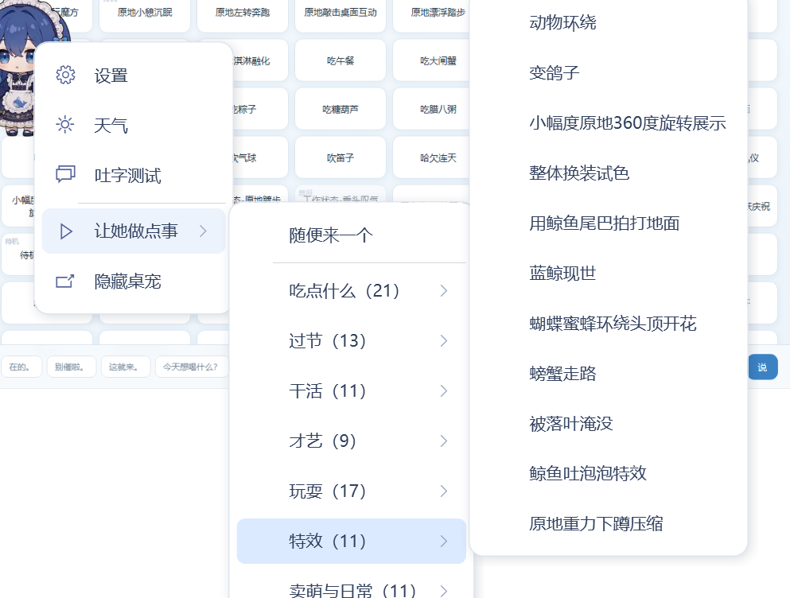
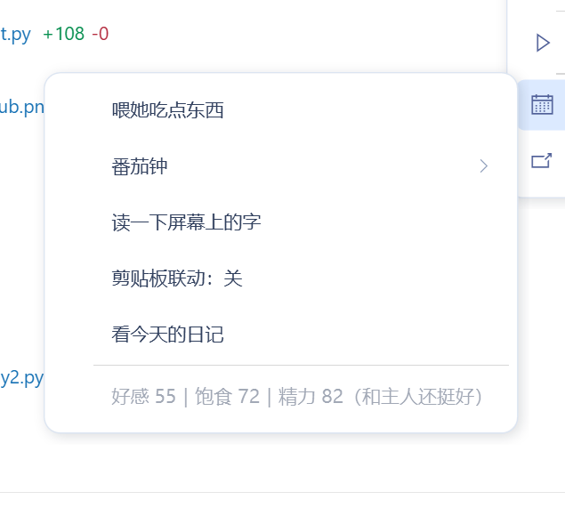

# 蓝色大肥鱼 · 八项改造

给「蓝色大肥鱼」桌面宠物（v1.0.1，C# / WPF）做的一整套功能补强。
全部**本地运行**：不调云端 API，不用你的 token，截图和文字都不出本机。

分两部分：

- **右键菜单**：新增「让她做点事」+「鱼鱼的日常」两个一级菜单，106 个动作分 10 组，随手点随手播。
- **八项功能**：工作识别、自定义动作、视觉升级、剪贴板联动、养成数值（右上角仪表）、生日、看屏幕汇报、番茄钟。

---

## 一、右键菜单

右键桌宠 → 「让她做点事」：


再往右一层是动作组，再往右一层是具体动作（三级级联）：



21 项的「吃点什么」会自动限高并出现滚动条，不会顶出屏幕：


### 分组一览（共 106 个动作，一个不落）

| 分组 | 数量 | 归类依据 |
|---|---|---|
| 吃点什么 | 21 | `Meal` 字段（15）+ 名字含「吃」 |
| 过节 | 13 | `Festival` 字段（12）+ 名字含节日物 |
| 干活 | 11 | `WorkKind` 字段（4）+ 名字含「工作状态 / 碎碎念 / 写代码」 |
| 才艺 | 9 | 名字含 舞 / 笛 / 魔术 / 魔方 / 五子棋 / 演奏 |
| 玩耍 | 17 | 名字含 玩 / 风筝 / 陀螺 / 撸猫 / 散步 / 跳跃 |
| 特效 | 11 | 名字含 鲸鱼 / 泡泡 / 环绕 / 换装 / 360 / 烟花 |
| 卖萌与日常 | 11 | 名字含 哈欠 / 伸懒腰 / 呼吸 / 待机 / 刷牙 |
| 互动反馈 | 6 | `Pool` 为 `Click` / `Drag`（点击、拖拽时的那套反应） |
| 其他动作 | 3 | 兜底，不丢 |
| 已停用 | 4 | `Pool` 为 `Disabled`，显示为灰色不可点 |

外加最上面的 **「随便来一个」** —— 从 102 个可用动作里随机抽一个播。

> 分组**不硬编码动作名**。作者以后加新动作，只要 `animations.json` 里标了
> `Meal` / `Festival` / `WorkKind`，或者名字语义正常，就会自动落进合适的组；
> 哪个都不匹配也只是掉进「其他动作」，不会消失。

### 第二个一级菜单：「鱼鱼的日常」



喂她吃东西、开番茄钟、让她看看你在干什么、剪贴板开关、看三个数值 —— 都在这里。

---

## 二、八项功能

### 1. 工作识别：她开始「陪着你工作」

`CompanionAnimationPolicy` 里本来就有「检测到写代码 → 播写代码动作」的权重逻辑，
但 `AnimationContext()` 把 `WorkRecognitionEnabled` 写死成 `false`，`IsWorking` /
`IsCoding` 从来没赋过值 —— 整套逻辑闲置。

现在新增 `CompanionWorkContext.Classify()`：读前台窗口的**进程名**（不看窗口内容、
不联网），命中 IDE 名单（VS / VS Code / Cursor / Rider / IDEA / Unity …）就算写代码，
命中办公名单（Word / Excel / PPT / WPS / PDF / Notion / Figma …）就算办公。
结果喂给动作权重，写代码时更容易播「写代码 / 碎碎念」，办公时更容易播「忙碌点按」。
设置页里可以关掉。

> 只查进程名，2 秒缓存一次，不枚举窗口内容。

### 2. 动作自加：现在能给她加新动作了

`Load()` 里原来有一句 `rules.Count != 106` 就抛异常 —— 你往 `assets/fish` 丢一个 webm、
改一下 json，**整个桌宠起不来**。

现在放宽成三条：不为空、动作名不重复、内置动作（待机呼吸 / 女仆屈膝 / 晨间刷牙）还在。
加了新动作写进 `animations.json`，**右键菜单会自动把它分到合适的组里**，不用改代码。

**而且这 106 个动作现在都会自己播**，不再只是点了才动：

| Pool | 数量 | 原版 | 现在 |
|---|---|---|---|
| `Event` | 91 | 40 秒自播 | ✅ 照旧 |
| `Idle` | 3 | 兜底待机 | ✅ 权重 ×0.6 |
| `Click` | 5 | ❌ 只在你点她时 | ✅ **权重 ×0.6，会自己播** |
| `Greeting` / `Daily` | 2 | ❌ 只在启动 / 23:00 | ✅ 权重 ×0.3 |
| `Drag` | 1 | ❌ 只在拖拽 | ❌ 仍然只在拖拽（得有人拖） |
| `Disabled` | 4 | ❌ | ❌ 作者标记停用，不播 |

关键在于作者的 `Weight` 字段跨度是 **0~1000（50 倍）**，再加上「只在夜里 / 只在冬季 /
只在节日前后 / 只在整点」这些约束会把权重直接压成 0 —— 所以像中秋赏月、堆雪人、
放烟花这些动作，一年里绝大多数时间**根本不可能出现**。

现在的做法：被约束掉的动作给保底值，再把权重开 0.35 次方把 50 倍跨度压到 4~5 倍，
最后对「刚播过的」降权。实测 2000 次采样：**101 个可播动作全部覆盖，一个没漏**，
中位动作约 55 分钟轮到一次，最稀有的约 4~8 小时一次。

开关在设置 → 鱼鱼的日常 → 「所有动作都会自己播」，关掉完全退回原版行为。

### 3. 从「读字」升级成「看图」（视觉模式）

这是质的差别。原来那版是 OCR 模式：用 Windows OCR 读屏幕上的**文字**，看不见画面，
所以她永远不知道你在打什么游戏、看什么视频、图里是什么。

现在改成多模态：把当前窗口截成 768px 的图，直接喂给 Qwen3.5-4B 的视觉编码器。

实测（本机 RTX 4060 Laptop 8G）：

| 项目 | 结果 |
|---|---|
| 输入模式 | `Vision`（`vision-status.json` 里可查） |
| 图片 | 768×461，JPEG，随请求一起发 |
| 首字延迟 | 3.1 秒（编码器在 CPU 上跑） |
| 识别效果 | 截了菜单截图，她能读出「随便来一个 / 吃点什么 / 过节 / 干活」这些菜单项，还注意到背景里的动漫头像 |

**关键坑：8G 显存放不下视觉编码器。**
mmproj 的计算图要一次性申请约 4.8 GB 显存，8G 卡上必然 `ErrorOutOfDeviceMemory`，
llama-server 直接崩（表现是请求返回 502、进程消失）。所以启动参数里加了：

```
--no-mmproj-offload        # 视觉编码器留在 CPU
--image-max-tokens 256     # 768px 图压到 256 个视觉 token
```

语言模型照旧全量上 GPU，只有编码那一步走 CPU —— 代价是每次多 2～3 秒，
换来的是不崩。她十几分钟才说一句话，这点延迟完全感觉不到。

> mmproj 文件（`models/Qwen3.5-4B-heretic.mmproj-f16.gguf`，642 MB）取自
> `unsloth/Qwen3.5-4B-GGUF`，和本机那份 4B 权重同架构，实测兼容。

### 4. 剪贴板联动

复制英文 → 她翻译；复制代码 → 她吐槽；复制链接 → 她猜内容。

`CompanionClipboard.Classify()` 只认三类（代码 / 链接 / 纯外文），其余一律不理 ——
宁可少触发，也不要把复制粘贴当成复读机。25 秒冷却、1200 字截断，走本地模型。

默认**关闭**，右键「鱼鱼的日常 → 剪贴板联动」自己打开。

### 5. 好感度 / 饱食度 / 精力（右上角仪表 + 数值规则）

三个 0～100 的数值，落盘在 `preferences.json`，**实时显示在她右上角**：


三格分别是 ♥ 好感、🍚 饱食、⚡ 精力，每条是一根短条：

- 平时安静待着，**低于 25 才轻轻脉动**（吸引注意但不烦人）
- 数值一变（喂食、摸头）那一条会闪一下，涨了看得见
- 点一下仪表，她说一句自己的状态（比如「好感 58｜饱食 76｜精力 84」）
- 气泡会自动往左让 44 px，不会盖住仪表

**数值怎么变**（参考 VPet 的斜率，但投喂调得更"耐喂"，怕两下就喂满没意思）：

| 事件 | 变化 |
|---|---|
| 喂她一次 | 饱食 **+2.5**、好感 **+5**、精力 +2 |
| 点她一下（摸头） | 好感 +0.5（涨得慢才金贵） |
| 时间流逝 | 饱食 **-1.5/时**；醒着精力 -5/时；23:00～8:00 精力 +8/时 |
| 长期不理（饱食或精力 < 20） | 好感 -1.2/时，否则只 -0.25/时 |

> **投喂一次只加 2.5**：饱食 50 → 100 正好要喂 **20 次**，喂她变成一个长期的日常动作。
> 既然涨得慢，衰减也从 4/时 降到 1.5/时，否则喂一次连 40 分钟都撑不住，永远补不回来。

离线最多补算 12 小时，隔三天回来不会发现她「饿死了」。

**好感度从哪来**（这次扩充，原来只有摸头和喂食两个来源）：

| 来源 | 加多少 | 递减 / 冷却 |
|---|---|---|
| 摸头（单击她） | +0.5 | 无 |
| 右键点任意一个动作 | **+0.5** | 同一个动作 10 分钟内重复只 +0.1 |
| 喂她吃一次 / 点某道菜 | **+5** | 10 分钟内再喂只 +1 |
| 双击找她聊天 | **+1** | 5 分钟最多一次 |
| 每发一条消息 | **+0.6** | 30 秒最多一次 |

递减不是小气：不这么写的话按住一个动作连点就能把好感刷满。现在想涨好感得**换着动作玩 +
偶尔喂一顿 + 找她说话**，正好也是"陪伴"该有的样子。实测累计 +10.20 与设计值完全一致。

**数值怎么影响她的行为**（这是这次改的重点）：

| 数值 | 行为 |
|---|---|
| 好感 ≥ 85 | 主动说话的间隔缩到 **0.55 倍**；语气变成黏人撒娇（「主人～」）；每 40 分钟有概率主动凑过来说一句 |
| 好感 60～85 | 间隔约 0.9 倍，自然亲近 |
| 好感 35～60 | 正常间隔，友好但克制 |
| 好感 < 15 | 间隔拉长到 1.4 倍，语气生分、话少 |
| 饱食 < 50 | **主动找你讨吃的**，45 分钟一次；< 25 时缩到 20 分钟一次，还会播吃饭动作 |
| 精力 < 22 | 白天会念叨「眼睛睁不开了」，夜里就安静地睡；主动说话间隔 ×1.7 |
| 精力 > 75 | 间隔 ×0.9，精神好就更爱说话 |

实测：饱食调到 10，她立刻说「主人…鱼鱼饿得有点晕了，真的不能吃一口吗…」；
好感 8 时语气客气，好感 96 时开口就是「主人～」。

**投喂动作**：从右键菜单「吃点什么」那一组 **21 个**里随机（吃早餐 / 涮火锅 / 吃西瓜 /
偷吃零食被抓住…）。实测 14 次投喂出现了 9 种不同的吃法，不再是原来固定那三个。

**反过来也通了**：在「让她做点事 → 吃点什么」里点某一道菜，她真的吃下去 —— 播你点的那个动作，
饱食同样 +2.5。不然会出现「明明看她吃了，饱食一点没涨」的怪事。

### 6. 生日

设置里填月/日，到点播庆祝动作（红包 / 烟花 / 雀跃 / 孔明灯）+ 说生日快乐，
同一年只触发一次（`LastBirthdayYear` 记着）。0 表示没设置。

### 7. 看屏幕汇报（替代原来的「抄字到剪贴板」）

右键「鱼鱼的日常 → 看看主人在干什么」。

她要做的**不是抄字**，是看懂画面，然后说两件事：主人在干什么 + 她自己的想法。
不往剪贴板写任何东西。

实测三条真实输出：

> 主人在写代码对比大模型效果呢，哇，这逻辑好清晰呀。唔，鱼鱼有点心疼，是不是写得太累了？

> 主人正在对着代码发愁呢，眉头都皱起来了。唔，鱼鱼觉得主人好厉害，居然能……

> 唔，主人～你在给大肥鱼写文档呀，还在跑测试！鱼鱼好佩服主人这么认真，但唔觉得……

耗时 3～4 秒（768px 截图 + 256 视觉 token），气泡留 40 秒后自己收起来。
人设里明确写了「不要汇报口吻、不要说根据截图、不要罗列界面元素」，不然 4B 模型很容易写成说明书。

> OCR 版（`CompanionInputMode=Ocr`）走另一条路：先用 Windows OCR 读出文字，再让模型根据文字猜 + 发表感想。

### 8. 番茄钟 / 久坐提醒

- 番茄钟：25 / 45 分钟两档，到点播「雀跃」+ 喊你起来喝水，右键菜单里显示剩余分钟
- 久坐提醒：连续坐着超过 90 分钟（可在设置里改）播「伸懒腰 / 哈欠」+ 提醒；
  离开电脑 2 分钟以上自动重新计时，不然一天会被提醒到烦

---

## 三、文件存在哪、会不会越用越满

**结论：不会，而且现在连日记也不写了。** 她**不保存聊天记录**（每句话都是现算现说，
说完就忘，历史对话不落盘），也不再有 `diary/` 目录 —— 所有文件都是覆盖写。

安装目录 `D:\deepseek\蓝色大肥鱼\` 下，程序自己生成的东西只有这些：

| 文件 | 大小 | 写法 | 会长大吗 |
|---|---|---|---|
| `preferences.json` + `.bak` | 各 ~1 KB | 覆盖写（数值变化时，2 分钟一次） | ❌ 固定 |
| `cache/weather.json` | ~2 KB | 覆盖写 | ❌ 固定 |
| `companion-errors.log` | 通常几十字节 | 只在出错时追加 | ⚠️ 已滚动 |
| `vision-input.jpg` | 36 KB | **只在测试模式写**，正常使用不生成 | ❌ |
| `vision-status.json` / `ocr-status.json` | ~1 KB | 同上，只在测试模式 | ❌ |
| `companion.lock` / `ready.status` | 0 / 5 字节 | 占位 | ❌ |
| `models/*.gguf` | 3.2 GB | 模型本体，一次性 | ❌ |

### 自动保洁（新增）

一天跑一次，开机也会跑一次，`CompanionHousekeeping` 做两件事：

1. **错误日志超过 512 KB 就滚动** —— 覆盖成 `companion-errors.log.old`（只留一份），
   主日志清空。防止某个报错循环刷爆磁盘。
2. **清掉上次留下的诊断文件** —— `vision-input.jpg` 里是**主人屏幕的截图**，
   虽然正常模式根本不生成，但万一之前开过测试模式，这里会把它删掉。

清完会在 `companion-errors.log` 里留一行，例如：

```
2026-10-25T16:19:04 保洁：清掉 2 个诊断文件
```

### 内存 / 显存：不会随时间涨

实测（她说完几句话、跑了半小时之后）：

| 进程 | 内存 |
|---|---|
| `llama-server.exe`（本地模型） | 3.87 GB |
| `BigBlueFish.exe`（桌宠本体） | 224 MB |
| `BigBlueFish.Mcp.exe` | 29 MB |
| 显存占用 | 4761 / 8188 MiB |

这些都是**常驻固定值**，不是缓存越攒越多：llama.cpp 的 KV 缓存上限由 `-c 8192` 卡死，
`--cache-ram 512` 又把内存里的 prompt 缓存封顶在 512 MB，而且**不落盘**
（没有磁盘 prompt cache，所以也不会有几十 GB 的缓存目录）。她聊十句和聊一千句，内存一样。

真要腾空间，右键「鱼鱼的日常」里关掉模型（设置 → 模型与供电），
或者退出桌宠，`llama-server` 会跟着退出，3.87 GB 立刻还给你。

---

## 四、改了哪些文件

工作副本在 `src/`（只拉了代码，没拉 52 MB 的 webm 素材）。

**新增：**

| 文件 | 作用 |
|---|---|
| `Companion/CompanionActionMenu.cs` | 动作分组 + 点击播放 |
| `Companion/CompanionDailyMenu.cs` | 「鱼鱼的日常」子菜单 |
| `Companion/CompanionDaily.cs` | 番茄钟 / 久坐 / 生日 / 剪贴板 / 看屏幕汇报 + 一秒一次的总闸 |
| `Companion/CompanionVitals.cs` | 三个数值的衰减、触发、喂食、摸头、按数值主动开口 |
| `Companion/CompanionVitalsHud.cs` | 右上角三格仪表（♥ 好感 / 饭碗 饱食 / ⚡ 精力）|
| `Companion/CompanionWorkContext.cs` | 前台进程名 → 写代码 / 办公 |
| `Companion/CompanionHousekeeping.cs` | 目录保洁：日志滚动、清诊断文件 |
| `Companion/CompanionMenuStyles.xaml` | `MenuItem` 模板补 `PART_Popup` + 展开箭头 |

**改动：**

| 文件 | 改动 |
|---|---|
| `Companion/CompanionMenus.cs` | 挂上两个新菜单 |
| `Companion/CompanionMenuDismissal.cs` | 点击判定把「已展开的子菜单」算进菜单范围 |
| `Companion/CompanionPreferences.cs` | 新增字段（数值 / 生日 / 剪贴板 / 番茄钟 / 自播开关）+ 说话间隔按好感与精力缩放 |
| `Companion/CompanionAnimations.cs` | `AnimationContext()` 接上工作识别 + **`ChooseAutoAction()` 全动作自播池** |
| `Companion/CompanionAnimationPolicy.cs` | 放宽 106 硬校验 |
| `Companion/CompanionBrain.cs` | 视觉参数（`--no-mmproj-offload`、`--image-max-tokens 256`）+ 看屏幕汇报入口 |
| `Companion/CompanionDialogue.cs` | 加汇报人设 + `IntimacyHint()` 按好感度调语气 |
| `Companion/CompanionNative.cs` | 补 `GetWindowThreadProcessId` 等 P/Invoke |
| `Companion/CompanionWindow.cs` | 主循环挂 `CompanionExtrasTick()`、测试命令（含 `auto-sample` 自播采样）、状态字段 |
| `Companion/CompanionSettings.cs` | 设置页加「鱼鱼的日常」页 |
| `Companion/CompanionMcp.cs` | 聊天输入框发送时涨好感 |

仓库里的 `patch/右键动作菜单.patch` 是完整补丁（基于上游 `v1.0.1`）：

```bash
git apply -p1 patch/右键动作菜单.patch
```

---

## 五、两个必须知道的坑（右键菜单为什么改样式）

这俩坑不填，菜单**看起来能开，但永远是死的**。

**坑一：`MenuItem` 模板里没有 `Popup`。**
作者把右键菜单的样式整个重写了，`CompanionMenuStyles.xaml` 里的 `MenuItem` 模板只有
`Border` + `Grid` + 两个 `ContentPresenter`，**没有任何承载子菜单的容器**。
WPF 的 `MenuItem` 靠模板里的 `Popup`（名字必须是 `PART_Popup`）来显示子项，
模板里没有，子菜单就永远不渲染 —— 连右侧那个小箭头都不会出现。

修法：把 `Border` 外面套一层 `Grid`，加 `Popup x:Name="PART_Popup"`，
`IsOpen` 绑 `IsSubmenuOpen`，再给 `Role=TopLevelHeader/SubmenuHeader` 显示箭头。
子项还要补 `ItemsPanel`（默认没设，展开会横向排），并加 `ScrollViewer MaxHeight=560` 限高。

**坑二：`CompanionMenuDismissal` 会把子菜单一起关掉。**
这个类用 `WH_MOUSE_LL` 全局钩子监听**鼠标按下**，一旦按下的位置不在主菜单矩形内，
就 `menu.IsOpen = false`。而子菜单是独立的 Popup 窗口，位置在主菜单矩形**右侧之外** ——
于是鼠标一按下去，整个菜单（含子菜单）在点击事件送达前就被拆了，点击永远到不了菜单项。

修法：`DismissOutside` 里加一次 `InsideOpenSubmenu` 递归检查，
把每个 `IsSubmenuOpen` 的子菜单的屏幕矩形（外扩 10px 容阴影）也算作「菜单内」。

---

## 六、编译与部署

SDK 在 `D:\dotnet-sdk\sdk10`。两种输入模式，二选一：

```powershell
cd D:\大肥鱼右键菜单\src\code

# 视觉版（推荐，能看见画面；需要 models 里有 mmproj 文件）
D:\dotnet-sdk\sdk10\dotnet.exe build BigBlueFish.Windows\BigBlueFish.Windows.csproj `
  -c Release -p:Platform=x64 -p:CompanionInputMode=Vision

# OCR 版（只用 Windows OCR 读字，不占显存，不需要 mmproj）
D:\dotnet-sdk\sdk10\dotnet.exe build BigBlueFish.Windows\BigBlueFish.Windows.csproj `
  -c Release -p:Platform=x64 -p:CompanionInputMode=Ocr
```

产物分别在：

```
bin\x64\Release\net10.0-windows7.0\BigBlueFish.dll           ← Vision
bin\x64\Release\net10.0-windows10.0.26100.0\BigBlueFish.dll  ← Ocr
```

**部署**（只替换这一个 dll，不要动 `runtimeconfig.json`，那是自包含发布的配置）：

```powershell
Get-Process BigBlueFish,BigBlueFish.Mcp -ErrorAction SilentlyContinue | Stop-Process -Force
Copy-Item <产物路径>\BigBlueFish.dll "D:\deepseek\蓝色大肥鱼\BigBlueFish.dll" -Force
```

当前部署状态：

```
D:\deepseek\蓝色大肥鱼\BigBlueFish.dll            5,521,920 字节  ← 视觉版（本次）
D:\deepseek\蓝色大肥鱼\BigBlueFish.ocr.bak.dll    5,536,768 字节  ← 上一版 OCR 备份
D:\deepseek\蓝色大肥鱼\BigBlueFish.dll.orig       5,495,296 字节  ← 原版备份
```

**还原原版：**

```powershell
Get-Process BigBlueFish,BigBlueFish.Mcp -ErrorAction SilentlyContinue | Stop-Process -Force
Copy-Item "D:\deepseek\蓝色大肥鱼\BigBlueFish.dll.orig" "D:\deepseek\蓝色大肥鱼\BigBlueFish.dll" -Force
```

> 替换时如果报 `Device or resource busy`，是因为桌宠被关掉后会被聊天桥
> （`fish_chat_bridge.py` 的 `ensure_fish()`）自己重新拉起来。
> 要么先停桥，要么「杀进程 + 立刻复制」在同一条命令里连着做。

**升级注意：** 作者发新版本后，新的 `BigBlueFish.dll` 会覆盖掉这些改动。
到时候重新 `git apply` 补丁再编译，或者直接告诉我重新打一次。

---

## 七、实测记录

不靠肉眼看截图：视觉走 `vision-status.json`（`inputMode` / `imageAttached` /
`elapsedMs`），其它走 `test-status.json` 的字段判定。

| 用例 | 结果 |
|---|---|
| 右键出菜单，两个一级菜单都在 | ✅ |
| 悬停展开 10 个分组 + 随便来一个 | ✅ |
| 分组计数 21/13/11/9/17/11/11/6/3/4 = 106 | ✅ |
| 点「随便来一个」→ 穿针乞巧 / External | ✅ |
| 三级：特效 → 动物环绕 / External | ✅ |
| 三级：吃点什么（21 项）→ 偷吃零食被抓住 / External | ✅ |
| 工作识别：前台 IDE → `isCoding=true`，动作权重生效 | ✅ |
| 视觉：`inputMode=Vision`、图片 768×461、首字 3.1s、认出菜单文字 | ✅ |
| 看屏幕汇报：说出主人在干什么 + 她自己的感想 | ✅ |
| 剪贴板联动：复制外文 → 气泡出现译文 | ✅ |
| 喂食：饱食 +2.5（87.42 → 89.92，Δ=2.50），好感 +5，对应仪表格闪一下 | ✅ |
| 投喂动作：14 次投喂出现 9 种不同吃法，全部落在「吃点什么」21 个里 | ✅ |
| 点菜单吃菜：`menu:吃早餐/涮火锅/吃西瓜` 各 +2.5，累计 71.68 → 79.18 | ✅ |
| 好感来源：点动作 0.5/0.1、喂食 5/1、开聊 1、发消息 0.6，累计 +10.20 与设计值一致 | ✅ |
| 自播采样 2000 次：101 个可播动作全部覆盖，Click 组 5 个各命中 5~11 次 | ✅ |
| 番茄钟：开始 / 停止、剩余分钟显示 | ✅ |
| 右上角仪表：三格图标 + 短条随数值平滑变化 | ✅ |
| 好感 8 → 语气生分；好感 96 → 语气黏人（同一画面两种说法） | ✅ |
| 饱食 10 → 主动开口讨吃的，仪表爱心格闪动 | ✅ |
| 低精力 → 自动播「原地小憩沉眠」 | ✅ |
| 保洁：启动时清掉上次遗留的 2 个诊断文件，日志留痕 | ✅ |
| 冷启动无异常，`companion-errors.log` 无新错误 | ✅ |

顺带一个行为：**提线木偶模式（`PuppetActive`）下点动作不会抢**，只会弹一句
「主人，现在是提线木偶模式，动作由外部接管啦～」。桌宠被隐藏时点动作会自动先把她叫回来。

---

## 八、目录

```
patch/右键动作菜单.patch  完整补丁（上游 v1.0.1 基线）
功能与轮询规则.md        所有功能的触发条件、三个定时器、自播权重算法（想搞清楚她什么时候动就看这个）
preview-*.png              截图
src/                    源码工作副本（改过的都在 src/code/BigBlueFish.Windows/Companion/）
_调试/                  编译验证用的脚本和过程截图，不影响使用
  _extras_test.py       日常功能回归（喂食 / 番茄钟 / 低数值 / 看屏幕汇报 / 语气分级）
  _feed_autoplay_test.py 投喂增量 + 投喂动作分组 + 自播采样
  _vision_test2.py      视觉模式验证（看图说话 + vision-status.json）
  _menu_shot.py         右键菜单截图
  dl/mmproj-F16.gguf    视觉投影文件原件（642 MB，已复制进部署目录）
```
